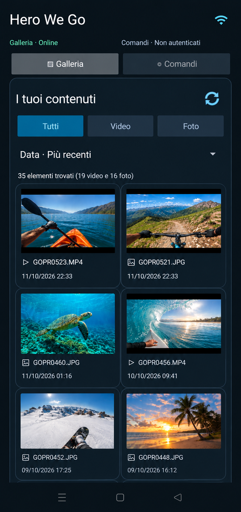
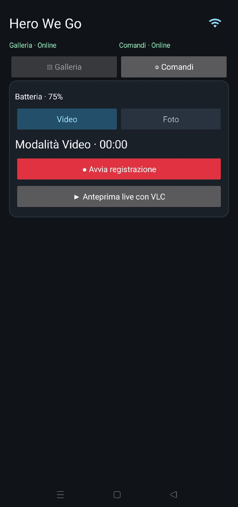

# Hero We Go

**Legacy Android remote and media browser for GoPro HERO3/HERO3+**

App in Italian, no PC or cloud needed.

  
  

## Download

**[GitHub Releases](https://github.com/smartm0use/hero-we-go/releases)** →
take the **Lite ARM64** APK (~54 MB, Android 8+, almost all modern phones).

## Use

1. Connect the phone to the camera Wi-Fi (GoPro App mode).
2. Use the **Galleria** tab to browse the camera contents.
3. Use the **Comandi** tab to take photos or record videos from your phone.

That's it. VLC preview is already inside, no extra app needed.
Stay on the camera Wi-Fi and keep the app open during downloads.

Slow loading / buffering is the old camera, not a bug.

## Developers

- Build: [`docs/BUILD.md`](docs/BUILD.md)
- Protocol: [`docs/PROTOCOL.md`](docs/PROTOCOL.md)

MIT, see [LICENSE](LICENSE). Not affiliated with GoPro or VideoLAN.
